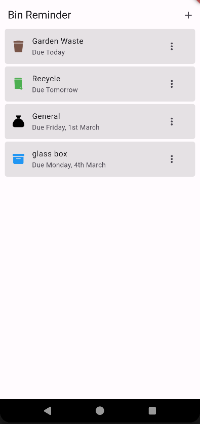
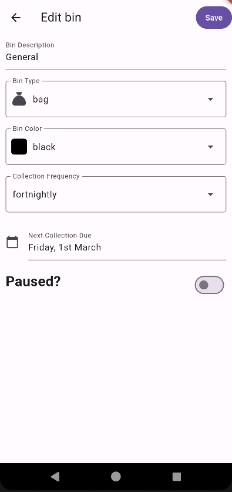

# 🗑️ Flutter Bin Reminder App

[](https://www.gnu.org/licenses/gpl-3.0)
[](https://flutter.dev/)

## 📱 Description
This application allows the user to enter the details about their bins (type, colour, etc) and the app will provide a notification to remind them to put them out for collection.

This sample application uses features such as local database storage, CRUD management, background services, navigation and unit testing.

Note: The application has only been tested on Android.

I have written a [Blog Post](https://jonclarke.dev/bin-reminder-application.html) about the development of this application.

## 🔃 How It Works
The user enters details of their bin, and the next collection date.  This uses a standard listview 
to list the bins, and tapping a record allows the user to view or edit the details.  A background 
service will check for collection due (either today or tomorrow) and display a notification on the 
users device to remind them about the collection.

Once the collect date has passed, the background service will update the collection date to the next
future due date.

## 🖥️ Instructions
To run the app you will need to install flutter.  Follow this [Get Started](https://docs.flutter.dev/get-started/install) guide.

- Clone the repository
```bash
git clone https://github.com/zjcz/bin_reminder.git
```
- Install the dependencies
```bash
flutter pub get
```
- Start the emulator or connect a device
- Run the application
```bash
flutter run
```

## 📸 Screenshots



## 📦 Packages Used
- [sqlflite](https://pub.dev/packages/sqflite) Flutter SQLite implementation, used to store the data.  I also used the [sqflite ffi](https://pub.dev/packages/sqflite_common_ffi) package to allow sqflite to work on non mobile devices, and when running unit tests.
- [font_awesome_flutter](https://pub.dev/packages/font_awesome_flutter) Font Awesome icons.  Used to illustrate the different bin types.
- [material_color_utilities](https://pub.dev/packages/material_color_utilities) Used to help provide better implementation of the Material Design 3 colour scheme. 
- [Jiffy](https://pub.dev/packages/jiffy) Jiffy is used to format dates.  I found this more powerful than the [intl](https://pub.dev/packages/intl) package.
- [flutter_local_notifications](https://pub.dev/packages/flutter_local_notifications) This package is used to trigger notifications.
- [clock](https://pub.dev/packages/clock) This package allows use to mock the current date/time within the unit tests

## 🧪 Testing
I have written a number of unit tests to test the basic functionality of the application.  These can be run using the following command:
```bash
flutter test
```

## 🚂 Motivation

This is the first Flutter app I developed as part of the learning process.  It lacks many production ready features and is not intended for release.  Feel free to fork the repo and build the app yourself for your own use.

## 📝 License
This project is licensed under the GNU General Public License v3.0 - see the [license.md](license.md) file for details.

## 📬 Request
While not a requirement of the license, I kindly request that you reach out to me if you plan to use this code for your own project. I'd love to hear if you find this useful!